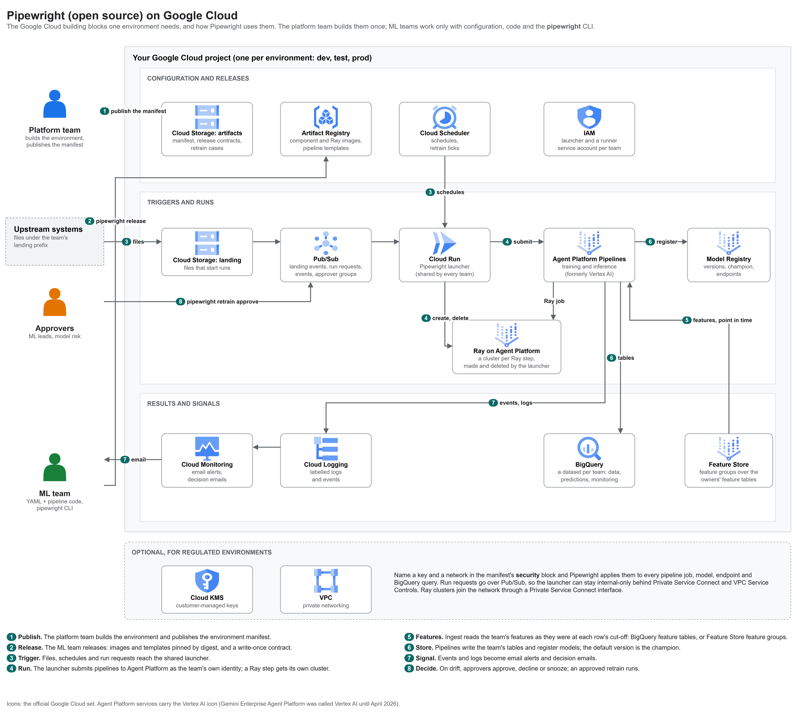

# Pipewright

**Configurable, governed MLOps on Google Cloud.** Build, release, run and monitor models from configuration, with a
human in the loop for every retrain decision.

Pipewright is open source under the [Apache License 2.0](LICENSE) and maintained by
[Fluxor Software](https://www.fluxorsoft.com/pipewright.html).

> **Status: alpha (0.4.0.dev0).** Working end to end on Google Cloud, including private environments with
> customer-managed keys and enforced organization policies, but the configuration format may still change before
> 1.0. Install from source for now; the package will be published to PyPI as `pipewright-mlops`.

## At a glance



<sub>Editable source: [docs/images/pipewright-architecture.drawio](docs/images/pipewright-architecture.drawio) (draw.io, official Google Cloud icons).</sub>

The platform team builds the environment once and publishes an **environment manifest**: the names of everything a
team may use. ML teams then work only with their own configuration and code; the `pipewright` CLI and the shared
launcher do the rest.

## Building blocks: what you need on Google Cloud

Pipewright does not create infrastructure. Before an ML team runs `pipewright`, the platform side provides these
resources in each environment's project and describes them in the manifest
(`src/pipewright/config/schemas/manifest.schema.json`).

| Building block | Google Cloud service | What Pipewright uses it for | Needed |
|---|---|---|---|
| Artifacts bucket | Cloud Storage | The environment manifest, release contracts and live pointers, pipeline roots, retrain cases | Always |
| Landing bucket | Cloud Storage, with a Pub/Sub notification | Files dropped under a team's prefix start runs | For file triggers |
| Registries | Artifact Registry: a Docker and a KFP repository (Python optional) | Component images and compiled pipeline templates, pinned by digest | Always |
| Pipelines | Agent Platform Pipelines (formerly Vertex AI Pipelines) | Training and inference runs | Always |
| Models | Model Registry; endpoints for online serving | Versions, the champion, approvals; serving with canary | Always (endpoints optional) |
| Team data | BigQuery: one dataset per team | Raw data, predictions, metrics and monitoring tables | Always |
| Launcher | Cloud Run, from `images/launcher.Dockerfile`, with its own service account | Turns files, schedules, API calls and run requests into pipeline runs; handles retrain decisions | Always |
| Identities | IAM service accounts: the launcher, one runner per team, CI (Workload Identity Federation) | Every pipeline step runs as its team's runner; nothing uses keys | Always |
| Messaging | Pub/Sub topics: landing events, run requests, lifecycle events, one per approver group | Triggers, runs from inside a private network, events for alerts and audit, approvals | Events and approvals recommended; run requests for private networks |
| Schedules | Cloud Scheduler | Scheduled runs; the hourly retrain tick and weekly digest | For schedules and retrain decisions |
| Alerts | Cloud Logging and Cloud Monitoring | Labelled logs, email alerts per use case, decision emails | Recommended |
| Encryption | Cloud KMS (customer-managed keys) | Applied to pipeline jobs, models, endpoints and BigQuery queries | Optional (regulated environments) |
| Private network | VPC, Private Service Connect, Private Services Access, VPC Service Controls | No public endpoints; pipeline workers peered with your network | Optional (regulated environments) |

**APIs to enable:** `aiplatform`, `artifactregistry`, `bigquery`, `cloudscheduler`, `iam`, `iamcredentials`,
`logging`, `monitoring`, `pubsub`, `run`, `storage` (all `.googleapis.com`), plus `cloudkms` for customer-managed
keys.

**Setting up the platform side.** This repository does not include Terraform for the environment. If you would like
help building one, or the Terraform we use, email [hello@fluxorsoft.com](mailto:hello@fluxorsoft.com) or open a
[GitHub Discussion](https://github.com/fluxorsoft/pipewright/discussions): we are happy to share, and it helps us
shape what comes next.

---

## The problem

Most organisations that put machine learning into production on Google Cloud hit the same gaps, team after team:

1. **Every ML team rebuilds the same plumbing.** Triggers, release scripts, registry conventions, drift monitoring,
   alerting and IAM are written again for each use case. Months pass between a working notebook and a model in
   production, and every team does it slightly differently.
2. **A pipeline run is not a release.** Ask "what exactly is running in production, and can we go back?" and the
   answer is usually a guess: images tagged `latest`, templates overwritten in place, no single record of what was
   approved.
3. **Platform and ML teams block each other.** ML teams wait on infrastructure tickets for buckets, datasets and
   permissions; platform changes break pipelines nobody told them about. There is no contract between the two.
4. **Settings live in code.** A gate threshold, a drift limit or a machine size needs a code change and an engineer.
   Dev and production quietly drift apart, so the model you tested is not quite the model you ship.
5. **Drift alerts lead to blind retraining, or to nothing.** Drift says the inputs changed, not why. An upstream
   data bug, a seasonal blip and a real change look the same. Automatic retraining bakes the bug into the next
   model or fits the blip; retraining on the same data does not improve anything. Ignoring alerts is worse.
6. **Governance is assembled after the fact.** Auditors and model-risk teams ask which data trained a model, who
   approved it, where it runs, which key encrypts it and why it was retrained. The answers come from spreadsheets
   and memory.
7. **Regulated environments break the usual tools.** Customer-managed keys on every query, no public endpoints,
   VPC Service Controls and enforced organization policies stop most off-the-shelf MLOps tooling at the door.

## How Pipewright closes them

| Gap | What Pipewright does |
|---|---|
| 1. Rebuilt plumbing | One shared launcher per environment starts runs from file drops, schedules and API calls for every team. A use case is a folder of configuration plus your own pipeline code; `pipewright new-usecase` starts one from a working example |
| 2. Runs are not releases | `pipewright release` builds the component image and every pipeline template, pins both by digest, writes a **write-once release contract**, verifies it, then moves a live pointer. `rollback` moves the pointer back |
| 3. Teams blocking each other | The platform team publishes one **environment manifest** per environment: the names of everything a team may use. App configuration refers to those names and never creates infrastructure. `pipewright doctor` checks the live environment and says who to ask for anything missing |
| 4. Settings in code | Data contract, features, training, evaluation gates, triggers, monitoring and retraining policy are declared in YAML, validated against JSON Schemas and checked against each other. Only a fixed list of keys may differ per environment, so production is the same model judged the same way |
| 5. Blind retraining | Drift or a performance drop opens a **retrain decision case** with a short decision pack (what moved, the trend, data checks, the champion, what retraining would use). Named approver groups approve, decline or snooze with their own identity; nothing trains until the required groups agree |
| 6. Governance after the fact | Every key moment is a lifecycle event and a labelled log line: releases, runs, evaluations, registrations, approvals, deployments, alerts and decisions, each with who did it. Tools and auditors read the record instead of reconstructing it |
| 7. Regulated environments | The manifest's `security` block (CMEK key, network, reserved ranges) is applied to every pipeline job, model, endpoint and BigQuery query at run time. Run requests travel over Pub/Sub, so the launcher can stay internal-only |

## What it looks like

A use case's operations file, owned and reviewed by the ML team:

```yaml
# usecases/churn/config/operations.yaml
monitoring:
  output_table: churn_model_monitoring
  drift: { enabled: true, method: psi, threshold: 0.2 }
  performance: { enabled: true, metric: auc, min: 0.7,
                 labels: { table: churn_outcomes, key: customer_id, label: churned } }
  alerts: { notify: [ml-team@example.com], events: [monitoring.alert, training.rejected] }

retraining:
  mode: propose                     # off | propose | candidate (trains, never promotes)
  when: [drift, performance]
  decisions: { notify: [ml-team@example.com], publish: true }
  approvals: { required: [ml-leads, model-risk] }
  snooze: { max_days: 14 }
```

And the lifecycle, from the MLOps repository:

```bash
pipewright new-usecase --name churn --tenant retention --owner team-retention
pipewright validate     --env dev                     # schemas, references, cross-checks, offline
pipewright doctor       --env dev                     # read-only checks against the live project
pipewright tables sync  --env dev                     # create tables; additive changes only
pipewright release      --env dev                     # build, pin by digest, verify, go live
pipewright run          --env dev --usecase churn --pipeline inference --source-uri gs://...
pipewright monitor status --env dev --usecase churn   # drift, performance, open retrain cases
pipewright retrain show   --env dev --usecase churn   # the decision pack
pipewright retrain approve --env dev --usecase churn --reason "real shift after the price change"
```

## Features

| Stage | Capabilities |
|---|---|
| Configure | Multi-file use cases (one concern per file), JSON Schema validation with path-qualified errors, `${...}` references to manifest names, per-environment overrides on a fixed list of keys, `resolve` to print the effective configuration |
| Data | Data contracts (types, ranges, allowed values, uniqueness, minimum rows), CSV and Parquet on GCS or BigQuery tables and views as sources, tables in BigQuery, Parquet on GCS (with external tables) or both, from one schema file |
| Train | Random, stratified and time splits; tuning with parallel trials; experiments; compute per step set in configuration (`steps`), patched into the compiled template with no code change |
| Evaluate | Metric gates, slice gates, calibration, explainability, comparison with the current champion on the same data, a model card |
| Release | Component image and pipeline templates by digest, write-once release contracts, a verify gate before going live, live pointers, rollback, several pipelines per use case (training and inference) released together |
| Run | A shared, multi-tenant launcher on Cloud Run: file drops, schedules (Cloud Scheduler), API calls and Pub/Sub run requests; deterministic run IDs, so retries never start duplicates |
| Serve | Model Registry with the default version as the champion, promotion following an approval policy, online serving with an approval gate, canary, promote and undeploy |
| Monitor | Feature drift and prediction drift (PSI) against training baselines, live performance once outcomes arrive, `monitor status`, email alerts configured in YAML |
| Decide | Retrain decision cases: modes, decision packs, approver groups with a quorum, snoozes and declines that expire, re-opening when things get worse, escalation, a weekly digest, an opt-in Pub/Sub feed for your own apps |
| Observe | Lifecycle events on Pub/Sub and labelled structured logs for every key moment, with no vendor code in pipelines |
| Protect | Personal data declared in the data contract and never used as a feature; erasure by key across a team's tables (BigQuery and Parquet) |
| Automate | `pipewright ci init` writes GitHub Actions workflows for pull requests, releases and operations, including self-hosted runners |
| Extend | Other packages add CLI commands through the `pipewright.commands` entry point, without patching the core |

## How it works

Two personas, one contract between them (the diagram at the top shows the flow):

- **The platform team** owns durable, shared and security-relevant resources, and publishes the environment manifest.
- **ML teams** own pipeline code, configuration, tables inside their dataset, releases, schedules and model
  versions. Neither side edits the other's files.
- **The launcher** is deployed once per environment and never redeployed for a model release: a release only moves
  a pointer to a new, verified contract.
- **Every step runs as the team's own identity**, with the environment's key and network applied from the manifest.

[CONTEXT.md](CONTEXT.md) describes the design, the decisions behind it and every interface in detail.

## Your code and Pipewright

Teams write their pipelines and ML code their own way. Pipewright needs only a small contract at the edges:

| | Free (your choice) | Fixed (the contract) |
|---|---|---|
| Layout | Pipeline file and function names, the components folder, how config is split into files (`include:` patterns), table schema file names | `usecases/<name>/usecase.yaml`, with `metadata.name` equal to the folder; overrides in `usecases/<name>/environments/<env>.yaml` |
| Pipelines | Steps, libraries, frameworks, models; anything inside a step (Ray on Vertex AI included) | Kubeflow Pipelines v2 (`kfp` pinned to the version Pipewright compiles with); every pipeline accepts `project`, `region`, `source_uri` and `run_id`; components take their image from `COMPONENT_IMAGE` |
| Configuration | Which sections you use; most have defaults | Optional `ml_config` parameter: when a pipeline declares it, it receives the resolved configuration (data contract, gates, monitoring, retraining) |
| Evaluation | How you compute metrics | Training writes an **evaluation record**, `evaluation.json` next to the model artifacts, with the metrics, slices and champion comparison (see below) |
| Files | | Configuration files end in `.yaml`; a `.yml` file is refused with a message to rename it |

**Pipewright checks the gates itself.** Your evaluation step may apply the gates, but Pipewright does not take its
word for it. Before a version becomes the champion (`pipewright model approve`) or is served (`pipewright
deploy-model`), Pipewright recomputes every metric gate, slice gate and the champion margin from the version's
evaluation record, against the configuration in force now. A rewritten evaluation step that drops a gate cannot
promote a failing model, and `pipewright model list` shows each version's result. The record:

```json
{
  "metrics":  {"auc": 0.81, "calibration_error": 0.03},
  "slices":   {"contract_length_months": {"12": {"rows": 400, "auc": 0.79}}},
  "champion": {"auc": 0.80, "_version": "3"},
  "decision": "approve"
}
```

`slices` is needed for slice gates; `champion` holds the champion's metrics on the same test data, or `null` when
there was no champion yet. The churn example writes this record in its evaluate and register steps.

## Getting started

### What you need

- **On your machine:** Python 3.11, [uv](https://docs.astral.sh/uv/), Docker (component images), and the Google
  Cloud CLI or Application Default Credentials.
- **On Google Cloud:** an environment with the [building blocks](#building-blocks-what-you-need-on-google-cloud)
  above and its environment manifest. [docs/ONBOARDING.md](docs/ONBOARDING.md) lists what the platform team hands to
  each ML team.

### Install from source

```bash
git clone https://github.com/fluxorsoft/pipewright.git
cd pipewright
uv sync --all-extras                # Python 3.11 virtual environment with the gcp and launcher extras
uv run pipewright --help
```

Or install the CLI into another environment from the checkout: `pip install "./pipewright[gcp]"`. Once it is on
PyPI: `pip install "pipewright-mlops[gcp]"` (the command is still `pipewright`).

### Your first use case

From an MLOps repository with an `environments/<env>.yaml` that points at your manifest:

```yaml
apiVersion: pipewright/v1
kind: Environment
metadata: { name: dev }
spec:
  manifest: gs://<artifacts-bucket>/pipewright/environment.json
```

```bash
pipewright new-usecase --name churn --tenant <your-tenant> --owner <your-team>   # copies the churn example
pipewright validate --env dev
pipewright doctor   --env dev
pipewright tables sync --env dev
git commit -am "churn: first release"     # releases are named after the commit
pipewright release  --env dev
```

The churn example (`examples/churn/`) is a complete reference: training and inference pipelines, components, a
data contract, gates, monitoring, retrain decisions, table schemas, tests and synthetic sample data. The full
walkthrough, including what the platform team hands over, is in [docs/ONBOARDING.md](docs/ONBOARDING.md).

**Credentials:** Application Default Credentials, or `GCLOUD_CONFIG=<gcloud configuration>` for refreshable gcloud
user credentials. Behind a TLS-inspecting proxy, set `REQUESTS_CA_BUNDLE`, `GRPC_DEFAULT_SSL_ROOTS_FILE_PATH` and
`PIPEWRIGHT_BUILD_CA_BUNDLE`.

## Commands

| Stage | Commands |
|---|---|
| Configure | `new-usecase`, `validate`, `resolve`, `doctor`, `test` |
| Release | `tables sync`, `release`, `status`, `rollback`, `schedules sync`, `alerts sync`, `ci init` |
| Operate | `run`, `model list`, `model approve`, `deploy-model`, `monitor status`, `data erase` |
| Decide | `retrain list`, `retrain show`, `retrain approve`, `retrain decline`, `retrain snooze` |
| Extend | `plugins` (commands added by installed packages) |

Every command takes `--env` and most take `--usecase`. `pipewright <command> --help` lists the options.

## Open source and Enterprise

Pipewright is open core. Everything an ML team uses is open source; Pipewright Enterprise adds what regulated
organisations need around it, through published extension points (manifest fields, launcher routes, CLI plugins),
never by patching this package.

| | Pipewright (this repository) | Pipewright Enterprise |
|---|---|---|
| CLI, configuration model, examples | Yes | Yes |
| Shared launcher, release contracts, rollback | Yes | Yes |
| Monitoring, alerts, lifecycle events | Yes | Yes |
| Retrain decisions with approver quorum | Yes | Yes |
| Private-managed Terraform blueprint (CMEK everywhere, private network, internal launcher, VPC Service Controls, organization policies) | No | Yes |
| Approver groups, decision feeds and scheduler jobs provisioned | You provide them | Yes |
| Evidence packs: a tamper-evident audit record per model version | No | Yes |
| Support, onboarding and platform build-outs | Community | Fluxor Software |

Enterprise enquiries: [fluxorsoft.com/pipewright](https://www.fluxorsoft.com/pipewright.html).

## Project status and roadmap

| Area | Status |
|---|---|
| App-team CLI, configuration model, ML lifecycle sections | Built and used end to end |
| Shared launcher, release contract v3, multi-pipeline releases | Built and used end to end |
| Retrain decisions | Built and used end to end |
| Private-environment support (CMEK, VPC, internal launcher, Pub/Sub run requests) | Built and used end to end |
| Promotion of a release between environments by digest | Planned |
| Kubeflow Pipelines on GKE (`kfp` adapter) | Planned |
| OpenTelemetry export, per-tenant pipeline roots | Planned |
| PyPI release (`pipewright-mlops`) | Planned |

Google Cloud only, by design. Pipelines are Kubeflow Pipelines v2; the example uses PyTorch.

## Development

```bash
uv sync --all-extras
uv run pytest                     # unit tests
uv run ruff check .               # lint
uv run --no-project --with-requirements examples/churn/tests/requirements.txt python -m pytest examples/churn/tests
```

[CONTEXT.md](CONTEXT.md) is the place to start before changing anything: requirements, decisions, design and
conventions, with stable IDs to refer to. See [CONTRIBUTING.md](CONTRIBUTING.md) for how to propose changes, and
[SECURITY.md](SECURITY.md) to report a vulnerability.

## License

Copyright 2026 Fluxor Software Limited. Licensed under the [Apache License, Version 2.0](LICENSE); see
[NOTICE](NOTICE). "Pipewright" and "Fluxor" are names of Fluxor Software Limited; the license does not grant
permission to use them beyond describing the origin of the work.
