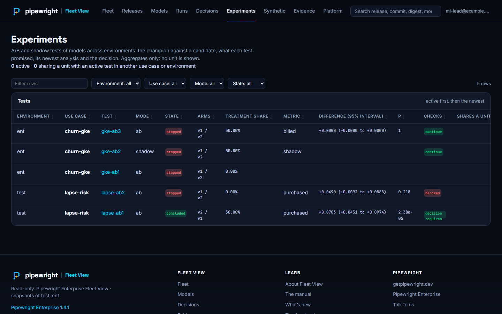
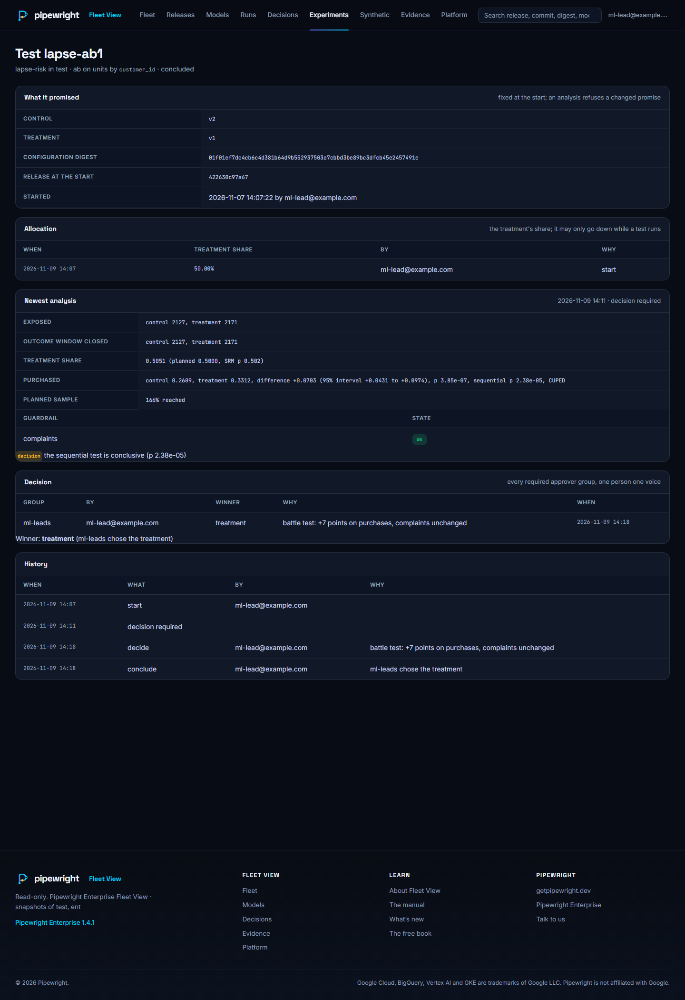
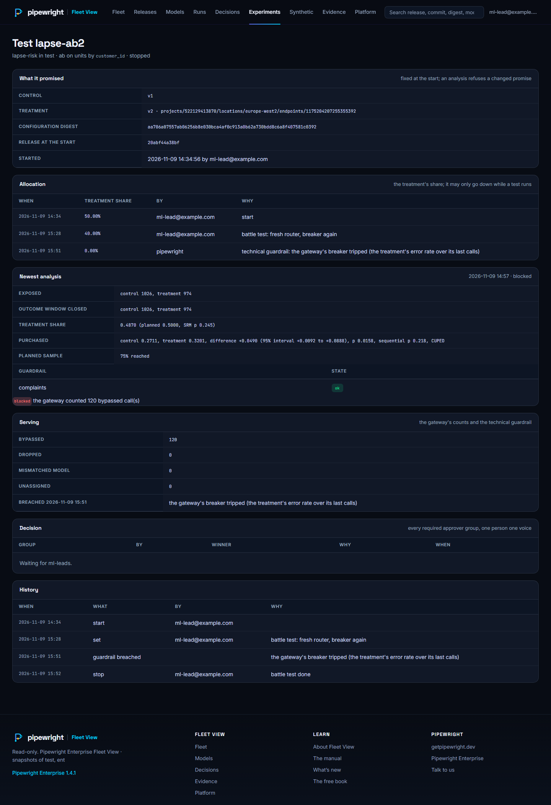
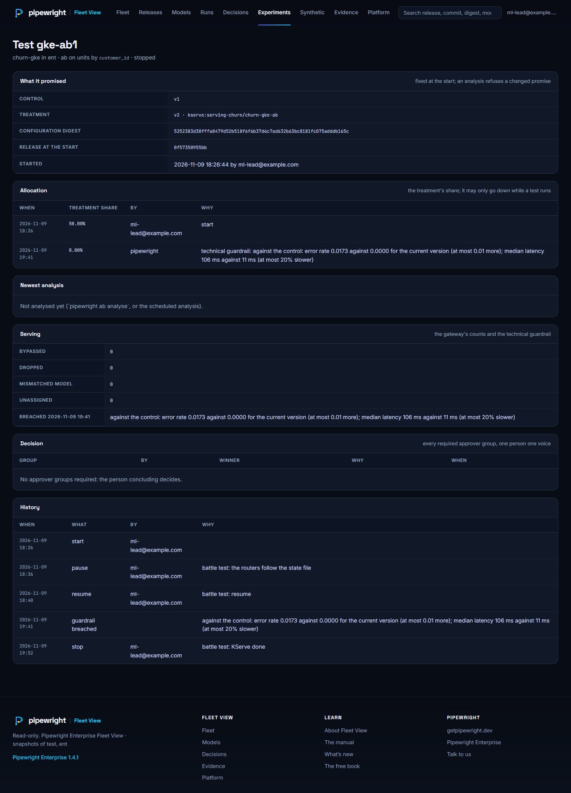
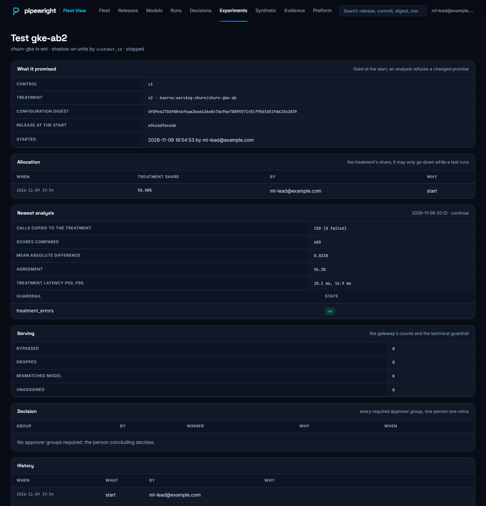
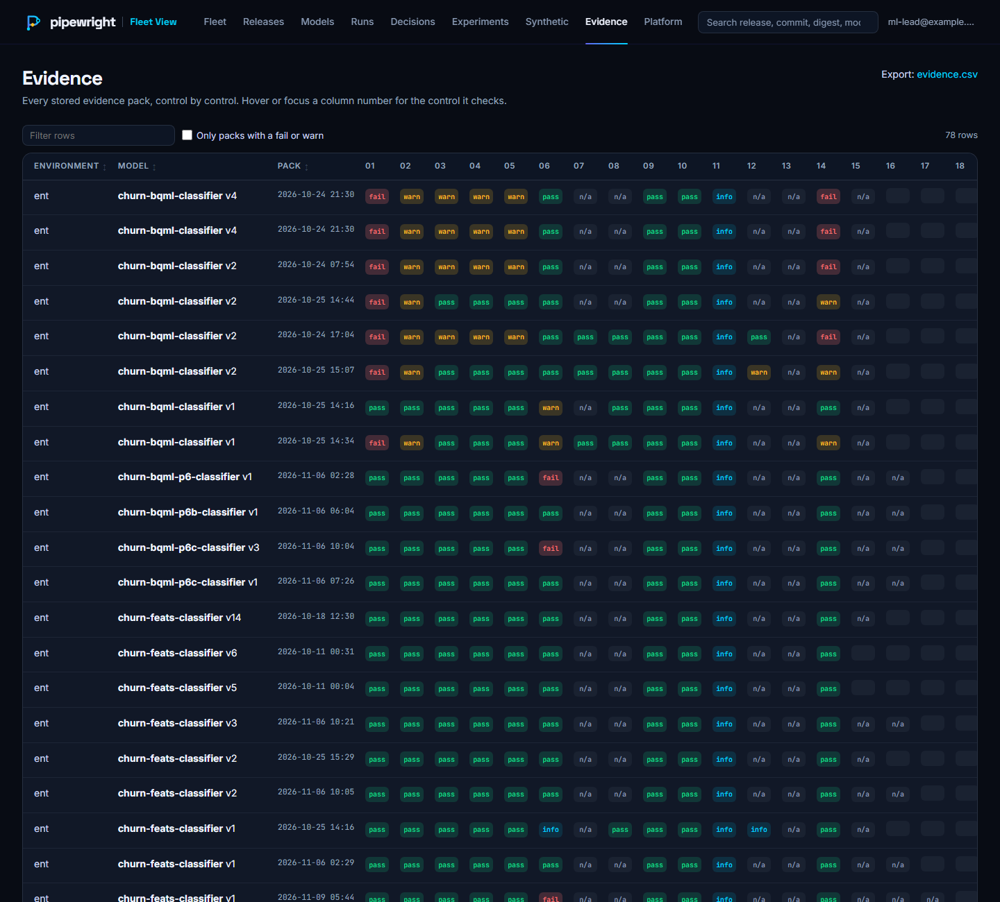
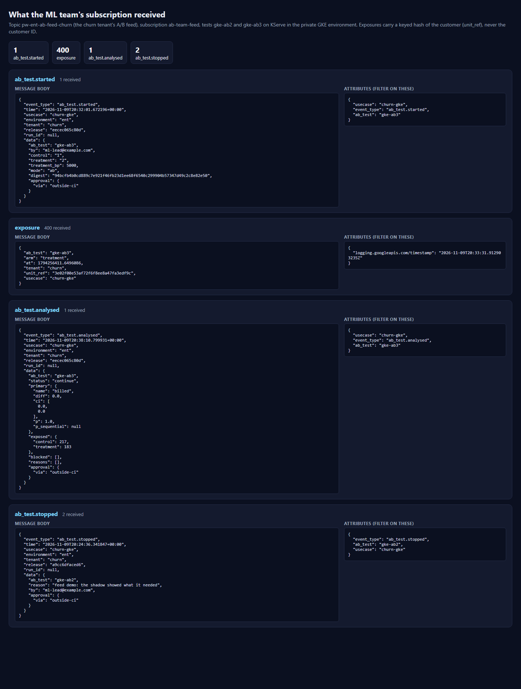

# A/B testing in Pipewright: a walkthrough

What an A/B test looks like from start to decision, and how an ML team collects the test's logs through Pub/Sub. The
screenshots come from the live battle test of FR-57 (2026-11-09): the book's lapse-risk model in the starter
environment (`test`) and churn-gke on KServe in a private GKE environment (`ent`). Email addresses in them are replaced
with `ml-lead@example.com`. The reference is [AB_TESTING.md](AB_TESTING.md).

## 1. Every test in one place



Fleet View's **Experiments** page lists every test the viewer may see, across environments: the mode (`ab` or
`shadow`), the state, the two versions, the treatment's share, the business metric with its difference and 95%
interval, and the share checks (`blocked` when the comparison is not clean). The subtitle counts active tests and tests
that share a unit with an active test in another use case or environment, because a customer in two tests at once
spoils both results. The open source CLI gives the same per use case: `pipewright ab list` and `pipewright ab status`.

## 2. From start to decision: a batch test



lapse-ab1 tested v1 (the treatment) against the default v2 on the weekly batch scoring, half the customers each. Read
the page top to bottom, as the team does before promoting a model:

1. **What it promised.** The two versions and a digest of the test's configuration, fixed at `ab start`. The analysis
   refuses to judge a test whose metric, unit or guardrails changed afterwards.
2. **Allocation.** The treatment's share and every change to it, by whom and why. It may only go down while a test runs.
3. **Newest analysis.** First the share checks: 0.5051 of customers in the treatment against 0.50 planned (SRM p 0.50),
   so the split is clean. Then the business metric on customers whose outcome window has closed: purchases 0.2609 in the
   control, 0.3312 in the treatment, a difference of +0.0703 with a 95% interval of +0.0431 to +0.0974. The
   sequential p-value (looked at daily, it only falls) is conclusive, the planned sample is passed (166%), and the
   complaints guardrail held. In this battle test the outcomes were generated with a planted effect, and the analysis
   recovered it exactly; the start date is moved back two days so that `min_days` had passed.
4. **Decision.** Every approver group the test requires decides through its topic, one person one voice. Here
   `ml-leads` chose the treatment, with the reason recorded.
5. **History.** Start, the analysis that made the decision due, the decision, the conclusion.

`pipewright ab conclude` then made v1 the default through the normal approval (its files checked against what was
approved), and both versions' lineage tells the story of the test.

## 3. When the comparison is not clean



lapse-ab2 ran online through the gateway on an Agent Platform endpoint. A caller with predict on the project could
reach the treatment's endpoint directly; the battle test did so 120 times. The launcher compares what the treatment's
endpoint answered (Cloud Monitoring) with what the gateway sent, records the 120 bypassed calls, and the analysis is
**blocked**: whatever the difference says, it is not evidence. Unassigned units, dropped exposure lines and answers from
a model other than the treatment's deployment block a decision the same way.

## 4. The safety net: the treatment stopped on its own



gke-ab1 ran on KServe in the private GKE cluster: the treatment as a second InferenceService, the router as a
Deployment in the tenant's namespace, a NetworkPolicy admitting only the router to the treatment. In the battle test the
treatment's InferenceService was deleted behind Pipewright's back. The router's breaker sent its customers to the
control at once; the launcher's hourly tick compared the arms from the routers' counts (an error rate of 0.0173 against
0.0000, a median time of 106 ms against 11 ms), set the allocation to **0% by `pipewright`** at 19:41 and opened the
decision. The routers follow a small state file, so the stop reached every pod within 30 seconds without anyone touching
the cluster. The history also shows a pause and a resume, done the same way.

## 5. Shadow: how the candidate behaves before anyone sees it



In `mode: shadow` the champion answers every call and a copy goes to the candidate in the background. Only a comparison
is logged: 150 calls copied, none failed, 600 scores compared, a mean absolute difference of 0.0238, agreement of
96.3%, the candidate's latency (10 ms at the median, 17 ms at the 95th percentile). A shadow shows behaviour, not
business value, so it never concludes for the candidate: the next step is an A/B test.

## 6. The evidence



Pipewright Enterprise builds an evidence pack for every version it approves or deploys. Control **EV-18** says whether
a version's tests ran as promised: the configuration digest recorded at the start, the allocation never raised, the
treatment approved for the test, the share checks clean when the treatment won, and every required approver group
decided.

## 7. Collecting the test's logs through Pub/Sub



The record of a test is BigQuery: the exposure table in the team's dataset and the results table. For the team's own
tools (a dashboard, an alert, a notebook that follows a test live) the platform gives each team a **feed**: a Pub/Sub
topic of its own.

**The platform team turns it on** for the team. In the starter, in `terraform.tfvars`:

```hcl
tenants = {
  churn = {
    ab_test = {
      feed             = true                                    # the topic and the tests' events
      feed_exposures   = true                                    # also per-unit exposures, pseudonymised
      feed_subscribers = ["serviceAccount:ab-dashboard@my-project.iam.gserviceaccount.com"]
    }
  }
}
```

In Pipewright Enterprise the same keys go under `spec.tenants.<team>.ab_test`, with `spec.policies.ab_test.feed_exposures:
true` to allow exposures at all (CMEK on the topic and the key). The manifest then names the topic:
`tenants.<team>.ab_test_feed.topic`.

**The team chooses what goes on it**, per test, in `config/ab_test.yaml`:

```yaml
ab_test:
  publish:
    events: true       # started, allocation changed, paused, resumed, analysed, guardrail breached, decided, stopped
    exposures: true    # one line per customer and call, with a keyed hash of the customer; only where allowed
    include_by: false  # the default: the feed's copy of an event leaves out who acted (see below)
```

**The team subscribes** with one of the identities in `feed_subscribers`, and keeps the messages it wants. Events
carry their kind as attributes (`event_type`, `ab_test`, `usecase`), so a subscription can take only some of them:

```bash
gcloud pubsub subscriptions create ab-dashboard \
  --topic=projects/my-project/topics/pw-ab-feed-churn \
  --message-filter='attributes.event_type = "ab_test.analysed" OR attributes.event_type = "ab_test.guardrail_breached"'
```

**Exposure lines have no such attributes.** They reach the topic through a Cloud Logging sink, and a sink adds only
a timestamp attribute, so a subscription filter cannot pick exposures, or one test's or one arm's. Two ways to work
with that:

- **Filter in the subscriber's code.** An exposure is a log entry whose `jsonPayload` has `unit_ref`; an event has
  `event_type` in its body. For example, in Python:

  ```python
  import json

  def handle(message):
      body = json.loads(message.data)
      line = body.get("jsonPayload") or {}
      if "unit_ref" in line:                                 # an exposure line
          if line["ab_test"] == "lapse-v7":
              record_exposure(line["unit_ref"], line["arm"], line["at"])
      elif body.get("event_type", "").startswith("ab_test."):  # an event
          record_event(body)
      message.ack()
  ```

- **Two subscriptions.** One with `--message-filter='attributes:event_type'` (only messages with that attribute: the
  events), and one without a filter for whoever wants the exposures as well.

Pipewright does not publish exposures itself, by design: the sink keeps Pub/Sub off the path of every prediction, so a
slow or unavailable topic can never slow down or fail a caller.

What arrives, as the battle test received it on KServe (the screenshot above):

| Message | When | What it carries |
|---|---|---|
| `ab_test.started` | `ab start` | the versions, the treatment's share, the mode, the configuration digest (who started it, with `include_by`) |
| `ab_test.analysed` | every analysis, scheduled or by hand | the status, the metric's difference, interval and p-values, the customers exposed per arm, what blocks a decision |
| `ab_test.guardrail_breached` | the launcher stops the treatment, or a business guardrail is breached | which guardrail, why |
| `ab_test.decision`, `ab_test.decided` | an approver group decides; the test concludes | the group, the winner, the reason |
| `ab_test.paused`, `resumed`, `stopped`, `allocation_changed` | those commands | why (and who, with `include_by`) |
| exposure lines | each customer routed online, within a few minutes | the test, the arm, `unit_ref` (a keyed hash of the customer), the time; never the customer's ID |

Things to know:

- **At least once, unordered.** A message can arrive twice and out of order; key on `event_type`, `ab_test` and
  `time`, and for exposures on `unit_ref` and `at`.
- **Exposures are pseudonymised, not anonymous.** The hash is stable for a customer, so it still counts as personal
  data where the customer is a person; keep it as you would keep the customer's ID.
- **To join exposures to the team's own records, use BigQuery, not the feed.** The exposure table in the team's own
  dataset (`pipewright_ab_exposure`) has the real unit, under the team's own access, so a join needs no key at all:

  ```sql
  SELECT e.jsonPayload.arm AS arm, c.region, COUNT(DISTINCT e.jsonPayload.unit) AS customers
  FROM `my-project.churn_ds.pipewright_ab_exposure` AS e
  JOIN `my-project.churn_ds.customers` AS c ON c.customer_id = CAST(e.jsonPayload.unit AS STRING)
  WHERE e.jsonPayload.ab_test = 'lapse-v7' AND e.jsonPayload.arm IN ('control', 'treatment')
  GROUP BY arm, c.region
  ```

  The feed's `unit_ref` is for tools that should never see the customer's ID; matching it back to customers needs the
  key, which only the gateway reads. Giving a team read access to the key in Secret Manager stays the platform's
  decision, and it turns the feed's exposures back into identifiable data for that team.
- **Events leave out who acted.** The event log, Fleet View and lineage keep `by` (an identity, never a customer);
  the feed's copy drops it, since the feed goes to the team's own tools. `publish.include_by: true` keeps it.
- **In a private environment**, the topic keeps messages in the environment's region and enforces it in transit: pull
  through the region's endpoint (for example `https://us-central1-pubsub.googleapis.com`).
- **BigQuery stays the record.** The analysis, the evidence and Fleet View read the dataset, never the feed.
