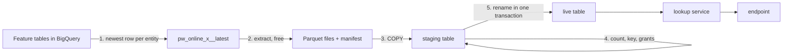

# Online feature stores: choosing one, setting it up, building your own

An endpoint with online features (`model.serving.features: online`) takes an entity ID, such as a customer ID, and
reads that entity's latest feature values before it scores. Those values live in an online store. Until Pipewright
1.4.2 there was one: Feature Store online serving on Bigtable. It is fast and it scales, and it costs about $781 a
month per node whether anyone calls it or not. Many use cases do not need that, so you can now choose:

| Store | A lookup, end to end | Standing cost a month (list price, London) | Choose it when |
|---|---|---|---|
| `bigtable` (Feature Store, the default) | about 12 ms | about $781 per node | high traffic, tight latency, large data |
| `cloudsql` (PostgreSQL, synced by Pipewright) | about 3 ms direct; about 12 ms through Pipewright's lookup service | about $61 (1 vCPU, 3.75 GB), plus about $14 per warm lookup instance | milliseconds on a budget |
| `bigquery` (BigQuery with BI Engine) | about 200 ms | about $38 per GiB of BI Engine reserved, no copy of the data | about 200 ms is fine and traffic is modest |
| `http` (your own store) | yours | yours | you already run a store, or want one Pipewright does not offer |

The figures come from live tests in europe-west2 (`docs/evidence/fr104-online-stores/`, including spike (d)). Your
offline features stay in BigQuery in every case: training and batch scoring read them point in time as before.

Nothing changes for anyone who does not set `model.serving.online_store`.

## How the YAML fits together

Three places, three owners:

| What | Where | Who |
|---|---|---|
| Which store a use case uses, its schema and table, the lookup service's size, the sync, the export | `model.serving.online_store` in the use case (`usecase.yaml`, overridable per environment in `environments/<env>.yaml`) | the ML team |
| Which stores an environment offers; the Cloud SQL instance's size; BI Engine; the lookup service's defaults, limits and floor | the platform's file: the starter's `online_store.yaml`, Enterprise's platform file `spec.features.online_store` | the platform team (an ML team changes it by pull request: one instance serves every team) |
| What the two agreed, for Pipewright to check | the environment manifest's `features.online_store` | written by Terraform |

A use case, every key with its default:

```yaml
spec:
  model:
    serving:
      enabled: true
      features: online                 # the endpoint takes entity IDs (needed for any online store)
      online_store:
        type: cloudsql                 # bigtable (default) | bigquery | cloudsql | http
        cloudsql:
          schema: public               # default public; give your team its own schema in a shared instance
          table: pw_online_<usecase>   # created and replaced at each sync
        lookup:                        # what sits between the endpoint and Cloud SQL
          provider: pipewright         # pipewright: Pipewright's Cloud Run lookup service | own: yours
          cpu: 1                       # 1, 2, 4, 6 or 8 vCPU (Cloud Run)
          memory: 512Mi                # up to 4Gi per vCPU; at least 2Gi with 4 vCPU, 4Gi with 6 or 8
          min_instances: 0             # warm instances; the environment's default and floor apply
          max_instances: 5
          concurrency: 80              # requests one instance serves at once
          pool_size: 8                 # database connections per instance
          timeout_ms: 1000
          cpu_boost: true              # Startup CPU boost: shorter cold starts
          billing: request             # request | instance (CPU always allocated)
          # reader: <sa>@<project>.iam.gserviceaccount.com   # provider own: who reads the table
        sync:
          mode: full                   # full | changed (only rows whose values changed)
        export:
          enabled: false               # publish Parquet with a manifest, for a store you build
          # uri: gs://<bucket>/<prefix>  # default gs://<artifacts bucket>/online-export/<tenant>/<usecase>
          keep: 3
          readers: []                  # who loads it: name@... or serviceAccount:name@... (1.4.2); the platform grants them
        # bigquery: { table: pw_online_<usecase>, timeout_ms: 1000 }
        # http: { url: https://..., audience: https://..., timeout_ms: 1000 }
  triggers:
    schedules:
      - { name: online, cron: "0 * * * *", timezone: Europe/London, pipeline: online_sync }   # refresh hourly
```

`pipewright validate` checks every size against what Google Cloud supports and against your environment's limits, and
names the key and the allowed values when one is wrong. `pipewright doctor` shows the store, what it costs and when it
was last synced, before anyone relies on it.

## The toggles

| Toggle | Default | On means |
|---|---|---|
| `model.serving.online_store.type` | `bigtable` | another store serves this use case |
| `lookup.provider` | `pipewright` | Pipewright's lookup service; `own`: you decide what sits between the endpoint and Cloud SQL (a service on GKE, your own Cloud Run, anything), and Pipewright syncs the table and grants your `reader` |
| `lookup.min_instances` | `0` (the platform may set a default and a floor) | instances kept warm, so callers do not wait for a cold start |
| `lookup.cpu_boost` | `true` | shorter cold starts |
| `lookup.billing` | `request` | `instance`: CPU always allocated, cheaper only for steady high traffic |
| `sync.mode` | `full` | `changed`: only rows whose values changed are written |
| `export.enabled` | `false` | each generation is published as Parquet with a manifest, for a store you build |

## Setting up each store

### BigQuery, and why plain BigQuery is never used online

A lookup in BigQuery without BI Engine scans the whole table: at 1M entities x 30 features that is 245 MiB billed per
lookup (about $0.0018), at about 290 ms. A thousand lookups an hour is about $1,300 a month. Pipewright refuses
`type: bigquery` in an environment without a BI Engine reservation.

With BI Engine, BigQuery serves lookups from memory and bills 0 bytes, at about 200 ms end to end (BigQuery's own
time is 120 to 280 ms; claims of a few milliseconds measure the engine alone). The platform reserves memory for the
environment (`bigquery.bi_engine_gib`, about $38 a month per GiB) and may name preferred tables.

What to know before you choose it:

- **The refresh window.** After each sync replaces the table, BI Engine reloads it. In our test, lookups ran
  unaccelerated for 8 to 10 minutes after a refresh of 1M rows (about half at first), and each was billed as a full
  table read: roughly $15 per refresh at 50 lookups a second. Refresh rarely and away from peak traffic.
- **Every unaccelerated lookup bills at least 10 MiB**, BigQuery's minimum per query, however small the table (found
  live: a 0.4 MiB table's lookups billed 10 MiB each with BI Engine off).
- **No cap can guard it.** BigQuery checks `maximumBytesBilled` against its estimate before BI Engine is asked, so a
  capped lookup is refused even when BI Engine would serve it for nothing. Pipewright detects instead: the launcher
  counts billed lookups by the serving identity and raises `online.billed`, which `pipewright alerts sync` turns into an
  alert.
- `doctor` fails when the reservation is missing, smaller than the table, or does not list it among preferred tables,
  and states what one unaccelerated lookup costs for your table.

Set up: the platform sets `bigquery.bi_engine_gib`; you set `type: bigquery` and a schedule with `pipeline:
online_sync`. The sync writes `pw_online_<usecase>` in your dataset: one row per entity, the newest value of each
feature.

### Cloud SQL

One PostgreSQL instance per environment, a schema per team. About 3 ms a lookup from inside the network; through
Pipewright's lookup service (for Agent Platform endpoints, which run outside your network) about 12 ms, of which the
service itself is 5 to 7 ms. One vCPU served about 800 lookups a second directly with p99 under 20 ms.

The instance (the platform's file), with what Cloud SQL offers:

| Key | Default | Allowed |
|---|---|---|
| `edition` | `enterprise` | `enterprise`, `enterprise_plus` (always written out: PostgreSQL 16 defaults to Enterprise Plus, which costs more) |
| `tier` | `db-custom-1-3840` (about $61 a month) | Enterprise: `db-f1-micro` (about $11, no SLA, tests only), `db-g1-small` (about $33), `db-custom-<vCPU>-<MB>` (vCPU 1 or even 2 to 96; 0.9 to 6.5 GB per vCPU, a multiple of 256 MB, at least 3840 MB), `db-custom-N4-<vCPU>-<MB>`. Enterprise Plus: `db-perf-optimized-N-<2..128>` (from about $221), `db-c4a-highmem-<2..72>`, `db-perf-optimized-C4-<2,4,8>` |
| `availability` | `zonal` | `regional`: high availability, about twice the compute (about $122 for the default tier) |
| `disk` | SSD, 10 GB, autoresize | `ssd`, `hdd` (Enterprise only), `hyperdisk` (N4, C4, C4A); can only grow |

What Pipewright sets up and keeps safe:

- **Private IP only, SSL required, IAM database login.** There is no password user anywhere: each identity logs in
  with its own access token. The lookup service verifies the database's certificate against the instance's CA.
- **A schema per team.** The sync runs as your team's runner and owns the schemas and tables it creates; PostgreSQL then
  keeps teams apart, and Pipewright refuses to write a table another identity owns. The default schema is `public`;
  `doctor` warns when you use it in an instance other teams share. The database itself is created by the platform's
  admin identity (`pipewright features online-setup`), never by a team, because whoever creates it owns `public`.
- **The lookup service** (when `provider: pipewright`): one Cloud Run service per use case and environment, named
  `pwl-<tenant>-<usecase>`, created by the launcher when you run `deploy-model` and updated each time. It runs as your
  tenant's lookup identity, internal ingress, egress into the environment's network only, a bounded connection pool.
  Your endpoint's identity is its only caller. `deploy-model --undeploy` asks the launcher to remove it (1.4.2), so
  warm instances stop billing and the network can be torn down; `--keep-lookup-service` keeps it.
- **Cold starts.** `min_instances: 1` keeps one instance warm (about $14 a month at 1 vCPU, 512Mi); Google may still
  restart it, so `2` keeps a spare (about $28). `cpu_boost` shortens the starts that remain. In our test the tail grew
  only while new instances started.
- **Where endpoints can reach it.** Agent Platform's public endpoints call from Google's network, outside yours. The
  starter lets them in (ingress all, still IAM-only: the endpoint's identity is the one caller). Enterprise's
  guardrails allow Cloud Run internal ingress only, so there an endpoint cannot call the lookup service; use the
  lookup gateway instead (`lookup.mode: gateway`, [SERVING.md](SERVING.md)): callers reach Pipewright's service inside
  the network, which reads Cloud SQL and calls the endpoint (public or private) itself.
  Inside the network the lookup service answered 50 of 50 calls at a p50 of 39 ms in our test.
- **Sizing.** `pool_size x max_instances` must fit the database's connection limit (100 on the default tier), shared
  with other use cases and the sync.

## The sync: how BigQuery reaches Cloud SQL



The launcher's scheduler starts it (a schedule with `pipeline: online_sync`); it runs as your runner in a Cloud Run job
inside the network. Each step and why it is there:

1. **One query for the newest values.** Each source's newest row per entity at or before now, joined on the entity
   key. Nothing from after the sync's as-of time is read.
2. **A free extract to Parquet**, with a **manifest**: each file's generation and SHA-256, the row count, the schema, the
   entity key, the as-of time and your feature contract's version (1.4.1). Files are checked against their SHA-256 as
   they are read.
3. **COPY into a staging table**, never the live one, so lookups never see half a load.
4. **Checks before the swap**: the staging row count must equal the manifest's, or nothing is swapped; then the key is
   indexed and your readers are granted.
5. **An atomic swap**: one transaction renames staging into place, with a lock timeout and retries. In our test it
   took 3 to 14 ms and no lookup failed.
6. **A record**: a `_pipewright_sync` row in your schema (the manifest's digest, contract version, rows, as-of), a sync
   record in the artifacts bucket for `doctor` and the watch, and an `online.synced` event. If no sync arrives for 48
   hours the launcher raises `online.stale`.

On one vCPU a full load of 1M rows raised lookup latency for about a minute (p50 from 12 to 20 to 33 ms). `sync.mode:
changed` writes only rows whose values changed; or choose 2 vCPUs; or schedule syncs away from peak traffic.

## Building your own store from the Parquet export

Turn the export on (`export.enabled: true`) and each sync publishes a generation:

```
gs://<artifacts bucket>/online-export/<tenant>/<usecase>/g20261107T171653Z/
  part-000000000000.parquet ...
  manifest.json
```

`manifest.json`:

```json
{"kind": "pipewright.online.generation", "generation": "g20261107T171653Z", "as_of": "2026-11-07 17:16:53+00",
 "entity_key": "customer_id", "rows": 5000,
 "schema": [{"name": "customer_id", "type": "STRING"}, {"name": "tenure_months", "type": "INTEGER"}, "..."],
 "files": [{"name": "online-export/.../part-000000000000.parquet", "generation": "1762535817...", "bytes": 108890,
            "sha256": "..."}],
 "feature_contract": {"version": "1.1.0", "sha256": "..."}}
```

A generation is never rewritten, and the last `keep` are kept.

**Publishing on a schedule, and who may read it (1.4.2).** With `type: http` and the export on, a schedule with
`pipeline: online_sync` publishes a new generation (nothing is loaded into a Pipewright store). Name the identities
that load your store in `export.readers` (`name@...` or `serviceAccount:name@...`); the platform grants them in its
`online_store.yaml` (`export_readers`, per tenant), which gives each reader `storage.objectViewer` on
`online-export/<tenant>/` only (listing by prefix) and gives the tenant the sync job the schedule runs. `validate` warns
about a reader the manifest says the platform has not granted. In Enterprise, a reader outside the perimeter also needs
an ingress rule.

The pattern we recommend for the loader, taken from what our own sync does:

- **Check before you load.** Compare each file's SHA-256 with the manifest, and the rows you loaded with `rows`.
- **Load beside, then swap.** Load into a staging table or collection, check it, then switch in one step: a rename, a
  view, an alias. Never load into what callers read.
- **Check every write.** Some batch APIs answer success while single writes fail: in our test Firestore's batchWrite
  answered 200 with about 4% of documents missing.
- **Load only what changed** where writes are charged one by one: compare with the previous generation.
- **Log in as an identity, never with a password**, and give each caller its own identity.
- **Bound your connections**: a pool per instance and a cap on instances; one connection per request exhausted the
  database in our test.
- **Keep connections alive** to HTTPS stores: a new connection per request cost seconds at 50 requests a second.
- **Keep the last good generation**, so a bad one can be reloaded or compared.
- **Record what you loaded**: the manifest's generation and the contract version, so serving can say what it served.
- **Alert on freshness**: when the newest loaded generation is older than your schedule allows.

Then plug your store back into serving with `type: http`: it answers `POST /lookup {"entity_ids": [...]}` with
`{"features": {id: {name: value}}}`, and Pipewright's handler checks the names and types it gets back, fills missing
values as training did and times out as configured. What happens inside your store is yours: Pipewright proves what it
exported and checks what comes back.

Other patterns you may choose with `lookup.provider: own` instead: keep Pipewright's Cloud SQL sync and put your own
service in front of it (pods on GKE, your own Cloud Run), reading the table with the `reader` identity Pipewright
grants. Pipewright tests only its own lookup service.

## Who may do what

| Who | Grant | Why |
|---|---|---|
| The platform's online store admin | IAM database user with `cloudsqlsuperuser`; `cloudsql.client`, `cloudsql.instanceUser`; read the manifest | creates the database and each team's grants (`features online-setup`), with no password |
| Your runner (the sync) | IAM database user; `CONNECT` and `CREATE` on the database, `USAGE` and `CREATE` on `public`; `cloudsql.client`, `cloudsql.instanceUser`; write `online-export/<tenant>/` and `online-sync/<tenant>/` | creates and owns your schema and tables; writes the extract, manifest and records; reads its sync request |
| Your lookup identity | IAM database user; `CONNECT`; `SELECT` on your tables (granted by the sync); `cloudsql.client`, `cloudsql.instanceUser` | the lookup service reads your table |
| The launcher | `run.admin`; act as each lookup identity and runner; `cloudsql.viewer`; create objects under `online-sync/`; list jobs (`bigquery`) | runs sync jobs; creates lookup services (Cloud Run cannot limit that by name, so the launcher does it and only for your tenant's names); pins the database's CA; hands each sync its request; alerts on billed lookups |
| Your endpoint's identity | `run.invoker` and `run.viewer` on your lookup service | calls it and reads its URL |

The live test found two of these missing in the first build (the launcher writing sync requests, and reading the
database's CA); both are in the Terraform now, and the launcher refuses to create a lookup service it cannot pin to
the database's CA.
